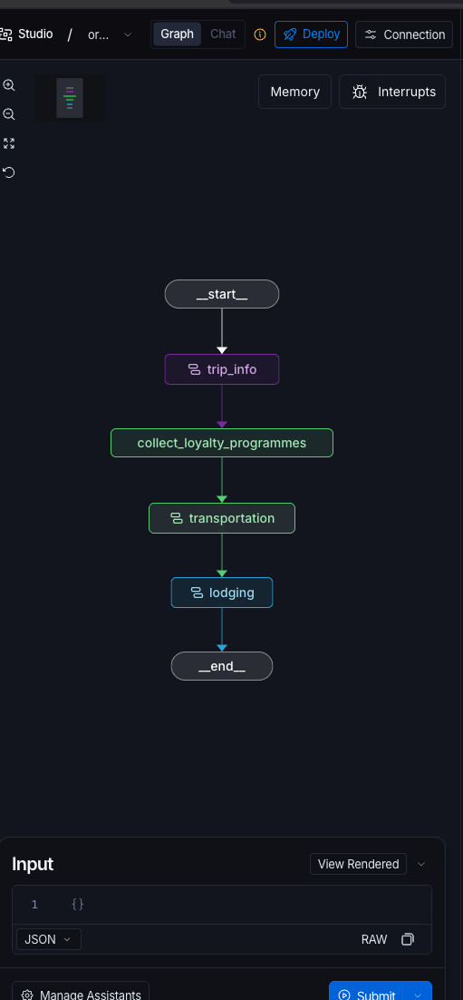
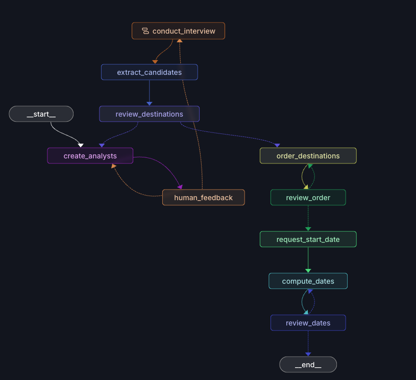
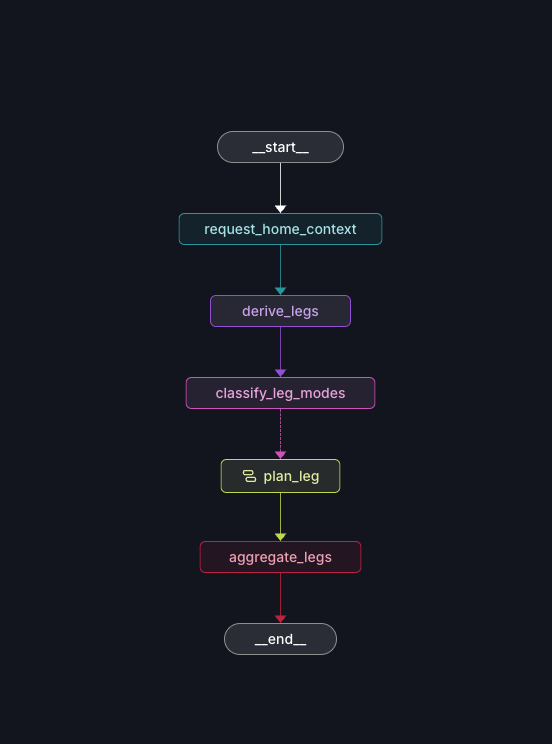
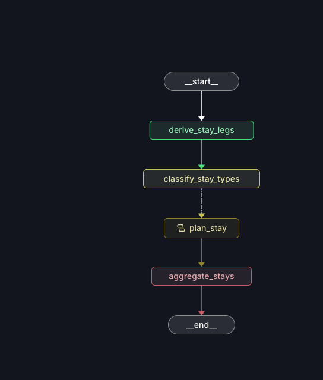
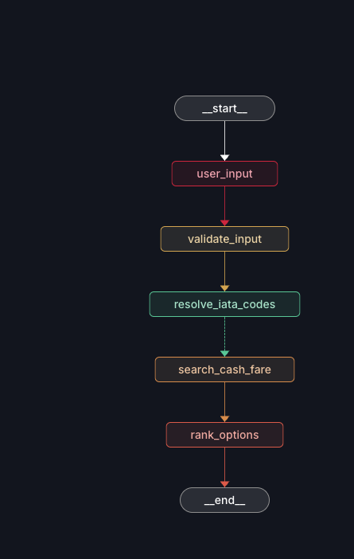

# AI Travel Planner

A multi-agent travel planner built on **LangGraph**. You describe a trip in plain language. A team of agents then researches destinations, sequences the route, sets dates, plans flights and ground transport for each leg, and recommends places to stay. The traveler reviews and steers every major decision through human-in-the-loop checkpoints.

> **Status:** The backend pipeline is complete and runs end to end in LangGraph Studio. The React frontend is in active development; every interrupt step has a working screen, and visual design is in progress.

<p align="center">
  
  <br><sub>The orchestrator graph as rendered in LangGraph Studio</sub>
</p>

---

## Highlights

- **Hierarchical multi-agent graph.** A parent orchestrator runs three planning subgraphs (destinations, transportation, lodging) on one shared checkpointer and one `thread_id`, so a single run carries the whole trip.
- **11 human-in-the-loop interrupts.** The traveler approves, reorders, or redirects the plan at every decision point. Feedback loops back into research instead of restarting the run.
- **Parallel research with `Send()` fan-out.** Each leg and each stay is searched concurrently across flight, ground-transport, OTA, hotel-chain, and editorial sources.
- **Cost-aware model routing.** A three-tier LLM factory sends high-stakes ranking to a premium model and high-volume extraction to a cheap one.
- **Durable, resumable runs.** Postgres-backed checkpoints mean a run can be paused, resumed, or reloaded after a browser refresh, and the frontend can navigate back through completed steps.
- **Deterministic dev loop.** A per-run `test_mode` replays cached API responses from Postgres, and frontend fixtures let every screen render without a live backend.

---

## Architecture

```text
              +------------------------------+
              | React + Vite frontend        |
              | @langchain/langgraph-sdk     |
              +------------------------------+
                 |                        |
   stream runs + |                        | back-navigation
   resumes       v                        v
+------------------------------+  +----------------------------+
| langgraph-api (:8123)        |  | webapp.py routes (FastAPI) |
| orchestrator + 3 subgraphs   |  | interrupt history          |
+------------------------------+  +----------------------------+
   |          |            |                    |
   |          |            +---------+----------+
   v          v                      v
+-------+  +------------------+  +----------------------------+
| Redis |  | External APIs    |  | Postgres                   |
| queue |  | OpenRouter       |  | checkpoints + test cache   |
+-------+  | Duffel, Tavily   |  +----------------------------+
           | frankfurter.app  |
           +------------------+

  All runs are traced to LangSmith.
```

### Orchestrator pipeline

```text
  trip_preferences
         |
         v
+-----------------------------+
| trip_info                   |  <-> human_feedback
| analysts, destinations,     |      review_destinations
| route order, dates          |      order_review
+-----------------------------+      start_date_request
         |                           date_review
         v
+-----------------------------+
| collect_loyalty_programmes  |  <-> loyalty_programmes_request
+-----------------------------+
         |
         v
+-----------------------------+
| transportation              |  <-> home_context_request
| per-leg fan-out:            |      transport_mode_review
| flights, ground, car rental |      leg_transport_review
+-----------------------------+
         |
         v
+-----------------------------+
| lodging                     |  <-> stay_type_review
| per-stay fan-out:           |      stay_review
| OTAs, chains, editorial     |
+-----------------------------+
         |
         v
  finalized itinerary

  <->  interrupt(): the run pauses for the traveler and resumes
       with their answer on the same thread
```

### Inside each planning stage

All three subgraphs follow the same loop:

```text
[Search] --> [Reconcile] --> [Recommend] --> [Review] --approve--> [Finalize]
    ^                                            |
    +----------------- feedback -----------------+

  Search     parallel Send() fan-out across sources
  Reconcile  tag results as corroborated or unverified
  Recommend  premium-tier ranking
  Review     interrupt(): approve, or send feedback back to search
```

### Graph views from LangGraph Studio

Each subgraph is registered in `langgraph.json`, so it can also be opened and run on its own in Studio. Expand a graph to see its full node layout.

<details>
<summary><b>trip_info</b>: analyst panel, destinations, route order, dates</summary>
<br>

</details>

<details>
<summary><b>transportation</b>: per-leg flight, ground, and car-rental planning</summary>
<br>

</details>

<details>
<summary><b>lodging</b>: per-stay search, FX normalization, loyalty matching</summary>
<br>

</details>

<details>
<summary><b>main</b>: standalone flight-search graph built on Duffel</summary>
<br>

</details>

### Human-in-the-loop checkpoints

| Stage | Interrupt | What the traveler does |
|---|---|---|
| Destinations | `human_feedback` | Reviews the generated research-analyst personas, approves or reshapes them |
| | `review_destinations` | Keeps, drops, or edits candidate destinations |
| | `order_review` | Approves or reorders the route |
| | `start_date_request` | Provides a trip start date |
| | `date_review` | Approves the dated itinerary |
| Loyalty | `loyalty_programmes_request` | Lists hotel and airline programmes to optimize for |
| Transportation | `home_context_request` | Sets home and return cities |
| | `transport_mode_review` | Chooses flight, ground, or car per leg |
| | `leg_transport_review` | Picks a specific option for each leg |
| Lodging | `stay_type_review` | Chooses hotel vs. alternative stay types |
| | `stay_review` | Picks a stay for each destination |

Each interrupt payload carries a `type` string. The frontend maps it to a matching review screen through a registry, with an explicit fallback component so an unrecognized type is shown rather than silently dropped.

---

## Key design decisions

**One checkpointer, compiled subgraphs.** The subgraphs are compiled *without* their own checkpointer so they inherit the orchestrator's. An interrupt raised deep inside a lodging fan-out branch surfaces directly to the client on the same thread, with no state copying between stages.

**Tiered LLM routing.** `llm_config.get_llm(tier)` returns one of three OpenRouter-backed models. Every call site passes its tier explicitly; a silent fallback to the premium model in one extraction node once cost about 3.8× more before usage logs caught it.

| Tier | Model | Used for |
|---|---|---|
| `premium` | Claude Sonnet 5 | Ranking, recommendations, retry-critical structured output |
| `mid` | Claude Haiku 4.5 | General reasoning |
| `cheap` | DeepSeek V4 Flash | High-volume extraction from search results |

**Reconciliation before recommendation.** Search results from several sources are cross-checked and tagged as corroborated or unverified before ranking, so the recommender sees data quality as well as data.

**Back-navigation from checkpoints.** `webapp.py` walks Postgres checkpoints across subgraph namespaces to rebuild the history of resolved interrupts for a thread, which lets the frontend show earlier steps without re-running the graph.

**Test mode for repeatable runs.** Passing `test_mode: true` in `config.configurable` routes Tavily calls through a Postgres cache keyed on the request, so development reruns are fast, deterministic, and free. Normal runs are unaffected.

---

## Tech stack

| Layer | Tools |
|---|---|
| Orchestration | LangGraph, LangChain, LangSmith |
| Models | OpenRouter (Claude Sonnet 5, Claude Haiku 4.5, DeepSeek V4 Flash) |
| Data sources | Duffel (flights, airport catalog), Tavily (search and extract), frankfurter.app (FX) |
| Backend | Python 3.11, Pydantic, FastAPI |
| Persistence | Postgres (checkpoints, test cache), Redis |
| Frontend | React 19, TypeScript, Vite, React Router, `@langchain/langgraph-sdk` |
| Infrastructure | Docker Compose, `langgraph-api` |

---

## Getting started

### Prerequisites

- Python 3.11+, Node 20+, Docker
- API keys for OpenRouter, Duffel, and Tavily (LangSmith optional)

### 1. Environment

Create `.env` in the repo root (it is git-ignored):

```bash
OPENROUTER_API_KEY=...
DUFFEL_API_KEY=...
TAVILY_API_KEY=...

# Optional: tracing in LangSmith
LANGCHAIN_TRACING_V2=true
LANGCHAIN_API_KEY=...
LANGCHAIN_PROJECT=ai-travel-planner
```

### 2a. Run in LangGraph Studio (quickest)

```bash
python -m venv venv && source venv/bin/activate
pip install -r requirements.txt
langgraph dev
```

Open the `orchestrator` graph in Studio, enter `trip_preferences`, and step through each interrupt.

### 2b. Run with Docker

```bash
langgraph build -t travel-langchain:latest
docker compose up -d        # API on http://localhost:8123
```

`docker-compose.override.yml` is picked up automatically for local development. Use `docker compose -f docker-compose.yml up -d` for a production-style run without it.

### 3. Frontend

```bash
cd frontend
npm install
echo "VITE_LANGGRAPH_API_URL=http://localhost:8123" > .env.local
npm run dev                 # http://localhost:5173
```

To render the screens without a backend, set `VITE_STUB_MODE` and `VITE_FIXTURE` to load a recorded interrupt from `frontend/src/fixtures/`.

---

## Project structure

```
├── trip_orchestrator.py        # Parent graph wiring the stages on one checkpointer
├── trip_info_graph.py          # Analyst panel, destinations, ordering, dates
├── leg_transportation_graph.py # Per-leg flight / ground / car-rental planning
├── lodging_graph.py            # Per-stay search, FX normalization, loyalty matching
├── main.py                     # Standalone flight-search graph + Duffel helpers
├── llm_config.py               # Three-tier get_llm() factory
├── models.py                   # Pydantic models for Duffel responses
├── cache_utils.py              # test_mode response cache
├── checkpoint_utils.py         # Checkpoint namespace discovery
├── webapp.py                   # FastAPI routes mounted on langgraph-api
├── langgraph.json              # Graph registration
├── *_graph.png, trip_orchestrator.png  # Graph renders from LangGraph Studio
├── docker-compose*.yml
├── migrations/                 # Postgres schema for the test cache
├── scripts/                    # Dev utilities (cached runs, resume helpers)
├── documentation/              # Design notes: caching, checkpoints, timeline
└── frontend/
    └── src/
        ├── components/interrupts/  # One review screen per interrupt type
        ├── hooks/ context/         # Thread streaming and state
        └── fixtures/               # Recorded interrupt payloads
```

---

## Engineering notes

Lessons from building this, kept here because they cost real debugging time:

- **One interrupt mechanism per node.** Combining compile-time `interrupt_before` with a dynamic `interrupt()` in the same node fires twice.
- **Disable streaming for structured output over OpenRouter.** Streaming partial JSON across parallel `Send()` branches caused cascading `CancelledError`s; `get_llm()` sets `streaming=False`.
- **Normalize Tavily responses.** `TavilySearch.invoke()` can return a string instead of a results dict on error, so all calls go through a normalizer.
- **Trace first.** Most failures happen inside a fanned-out branch, where a stack trace loses the leg or stay context. LangSmith traces are the primary debugging tool.

---

## Roadmap

- [ ] Frontend visual design pass
- [ ] Pre-arrival leg for late arrivals at the first destination
- [ ] Validate DeepSeek structured output against Claude on extraction nodes
- [ ] Narrow the orchestrator `input_schema` so new runs need only `trip_preferences`
- [ ] Hosted demo

---

## Author

**Owen Hong** · [GitHub](https://github.com/owenhong0)